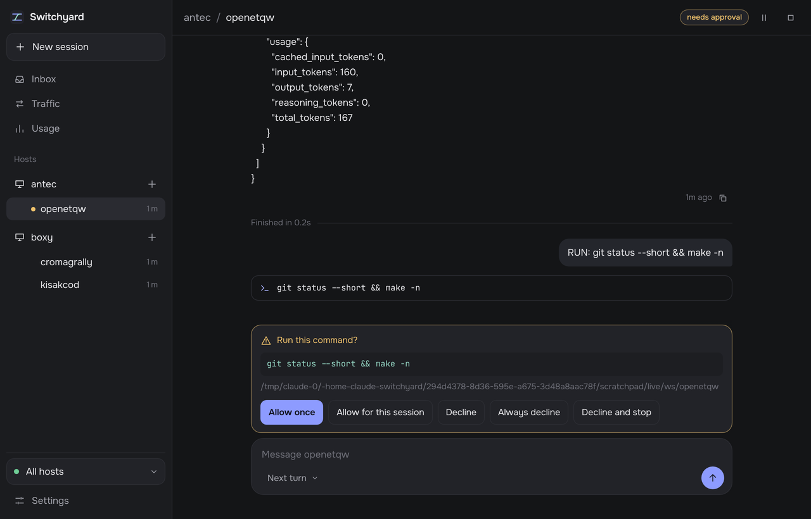

# Switchyard

[](LICENSE)
[](https://github.com/jm2/switchyard/actions/workflows/ci.yml)

A self-hosted **control plane for coding agents** spread across several of your machines,
written in dependency-free **Go**.

Switchyard shows every agent session on every host in one place, from a browser, your phone or
the `swyd` command line. Start new sessions on any machine, answer their approval prompts, and
message them while they work. Agents get fleet tools too, so one agent can ask another on a
different machine for help. Switchyard manages harnesses; it is not one. The agent work is done
by the tools you already use, under your own sign-ins.



> **Pre-release.** Switchyard is tested on Linux; the macOS and Windows builds have had little
> real use. Build it from source for now. Per-area status and how each part was verified
> are in [`docs/status.md`](docs/status.md).

## Features

| Feature | Status |
| --------- | -------- |
| Codex sessions through `codex app-server` | ✅ |
| Goose sessions through the Agent Client Protocol (`goose acp`) | ✅ |
| Other ACP agents, configured by name | ⚠️ Experimental |
| Antigravity `agy` sessions through its headless mode | ⚠️ Experimental; not yet run against a real `agy` |
| One fleet view of every session on every host | ✅ |
| Start, stop, interrupt and resume sessions on any host | ✅ Sessions resume after a node or coordinator restart |
| Approval prompts relayed to the web UI and CLI | ✅ Codex, Goose and other ACP agents |
| Steer a running turn | ✅ Codex; other harnesses queue the message for the next turn |
| Agent-to-agent messaging across machines (`fleet_ask`, `fleet_send`, `fleet_spawn`, ...) | ✅ Hop limits, rate limits, spawn depth and a daily token budget |
| Questions from agents to you, with an inbox | ✅ |
| Web UI for desktop and phone | ✅ Dark by default, with Light and Match-system themes |
| Sign in on a phone with a one-time link | ✅ |
| Live streaming of turns, diffs and token usage | ✅ |
| Private CA, mTLS between nodes and coordinator, one-time enrollment tokens | ✅ |
| No runtime dependencies; web UI loads nothing from the internet | ✅ |
| Fake model provider for trying everything without spending tokens | ✅ OpenAI Responses and Anthropic Messages |
| Linux | ✅ |
| macOS, Windows | 🚧 Built and packaged with service files; little real use yet |
| Push notifications | 🚧 Not yet; the tab title and inbox count show what needs you |
| Event log retention | 🚧 Session logs are kept indefinitely |
| Observing sessions started outside Switchyard | 🚧 Future release |

---

## Architecture

```text
   browser · phone · swyd CLI
               │  HTTPS + server-sent events (port 7480)
     ┌─────────┴─────────┐
     │    coordinator    │  one always-on machine:
     │                   │  event log · message router · web UI
     └─────────┬─────────┘
               │  JSON lines over mTLS, opened by each node (port 7481)
   ┌───────────┼────────────┐
 node        node         node      one per workstation, running as you
   │           │            │
 codex       goose         agy      harnesses, over stdio
```

- The **coordinator** stores every session's event log, routes messages between sessions and
  people, and serves the web UI and API. It needs no harness installed.
- A **node** runs on each workstation as your user, so sessions use your sign-ins,
  repositories and toolchains. Nodes dial the coordinator and open no inbound ports; a node that
  loses its connection keeps its sessions running and replays their events when it reconnects.
- Each **harness** is driven over its own protocol: JSON-RPC on stdio for `codex app-server` and
  ACP agents, and agy's `stream-json` output. `swyd mcp` gives each session its fleet tools.
- Sessions are addressed as `host/name`, for example `devbox/api-server`.

Design decisions are recorded in [`docs/decisions.md`](docs/decisions.md).

---

## Installation

Switchyard has no distribution packages yet. Tagged releases publish `swyd` archives for each
supported platform, with a `SHA256SUMS.txt`, on the [Releases](https://github.com/jm2/switchyard/releases)
page; otherwise build it from source (below). Put the `swyd` binary on each machine's `PATH`. The examples use `~/.local/bin/swyd` on Linux, `/usr/local/bin/swyd`
on macOS and `C:\tools\swyd.exe` on Windows.

### Supported platforms

| Platform | Architectures | Coordinator | Node |
| ---------- | --------------- | ------------- | ------ |
| Linux | x86_64, ARM64 | ✅ | ✅ |
| macOS | Apple silicon | 🚧 Little real use yet | 🚧 Little real use yet |
| Windows | x86_64 | 🚧 | 🚧 Not yet tested on real hardware |

## Building from Source

### Prerequisites

- Go 1.27 or newer (the `go` command fetches the exact toolchain in `go.mod`, 1.27.2, if yours is older)
- `make` (optional; the targets are short `go build` commands)

```bash
git clone https://github.com/jm2/switchyard
cd switchyard
make build                         # ./swyd for this machine
install -Dm755 swyd ~/.local/bin/swyd           # Linux
sudo install -m755 swyd /usr/local/bin/swyd     # macOS
```

To build for your other machines from one place:

```bash
make cross   # dist/swyd-{linux-amd64,linux-arm64,darwin-arm64,windows-amd64.exe}
```

---

## Setup

### 1. The coordinator

Pick a machine that is always on and that every workstation can reach. A
small home server is ideal.

```bash
swyd coordinator init --host coord.lan,10.0.0.5
```

`--host` lists the names and addresses the server certificate covers. The
first one is what nodes and the CLI will dial. Add a Tailscale name too if
you use one. `init` creates a private CA, the server certificate and an
admin token, and installs a CLI config for your user on this machine.

Start it, ideally as a service (the unit is in
[contrib/systemd](contrib/systemd/swyd-coordinator.service)):

```bash
swyd coordinator run
```

It listens on port **7480** (web UI, API and CLI) and **7481** (nodes).
Allow both through the firewall from your workstations only.

> **Keep both ports on a private network or a tailnet, never the open
> internet.** They are authenticated and encrypted, but Switchyard is not
> hardened for internet exposure. To reach the web UI from elsewhere, use a
> VPN or `tailscale serve` (see [docs/web-ui.md](docs/web-ui.md)).

### 2. Each workstation

Install and sign in to the harnesses you want to use there (see
[Harnesses](#harnesses)). Then enroll the machine with a one-time token
from the coordinator. The token carries the coordinator's address and CA
fingerprint, so there is nothing else to copy:

```bash
# on the coordinator
swyd coordinator enroll-token devbox
# on the workstation, with the token it printed
swyd node enroll <token>
```

or in one step over SSH:

```bash
swyd node enroll "$(ssh coord.lan swyd coordinator enroll-token devbox)"
```

The host name you give the token (`devbox`) is how the fleet names that
machine. Then run the node as your user, ideally as a service so it
survives logouts and reboots:

| OS | Service file |
| --- | --- |
| Linux | [systemd user unit](contrib/systemd/swyd-node.service) (enable lingering, as the file explains) |
| macOS | [LaunchAgent](contrib/launchd/dev.switchyard.node.plist) (set `PATH` so your harnesses resolve) |
| Windows | [logon task](contrib/windows/install-node-task.ps1) (runs in your session, so it can use your sign-ins) |

or in a terminal:

```bash
swyd node run
```

`swyd hosts` on the coordinator should now show the machine as online,
with the harnesses it found.

### 3. The CLI on other machines

The CLI works anywhere that can reach port 7480. Copy its config from the
coordinator:

```bash
ssh coord.lan swyd coordinator cli-config > ~/.config/swyd/cli.json
```

The file holds the admin token, which controls the whole fleet: keep it
private (`chmod 600`), and do not copy it to a machine where agents run:
harness sandboxes limit writes, not reads, so an agent there could read it.
On those machines, use the web UI from your phone or another computer
instead.

### 4. The web UI

Open `https://coord.lan:7480/`. Because the certificate comes from the
fleet's own CA, the browser warns at first. Either:

- install the CA: open `https://coord.lan:7480/ca.crt` and trust it (on
  iOS: Settings, General, About, Certificate Trust Settings), or
- put the UI behind `tailscale serve` for a publicly trusted certificate
  (see [docs/web-ui.md](docs/web-ui.md)).

Sign in with the token from `cli.json`, or run `swyd ui-link` anywhere the
CLI works and open the one-time link it prints. That is the easy way to
sign in on a phone.

---

## Usage

### Your first session

In the web UI, describe a task in the box at the bottom of the home screen, pick the host,
harness and folder, and send. Or from the CLI:

```bash
swyd spawn devbox --cwd ~/src/myapp --name myapp "run the tests and fix what fails"
swyd attach devbox/myapp         # follow it live; Ctrl-C detaches
```

### Everyday commands

```bash
swyd ls                                   # every session on every host
swyd send myapp "also update the changelog"          # next turn
swyd send --steer myapp "skip the docs for now"      # into the running turn (Codex)
swyd approve myapp <approval-id> accept   # or answer in the web UI
swyd interrupt myapp
swyd stop myapp                           # history is kept
```

A bare session name works when it is unique across the fleet.

Agents get fleet tools (`fleet_list`, `fleet_ask`, `fleet_send`,
`fleet_spawn`, ...), so a prompt like "ask buildbox/helper whether the ARM
build passes" makes one agent ask another on a different machine. You can follow and join in:

```bash
swyd messages                 # who said what to whom
swyd inbox                    # questions agents asked you
swyd reply <ask-id> "ship it"
swyd ask helper "status?"     # ask an agent yourself and wait for the answer
```

Guards in `coordinator.json` bound what agents can do to each other: hop
limits, rate limits, spawn depth and a fleet-wide daily token budget
(`guards.max_daily_tokens`; set one before letting agents spawn freely). By
default an agent spawns only on its own host, with its own harness, inside
its own working directory, and its children inherit its approval policy and
sandbox; agents steer, interrupt and stop only sessions they spawned. See
[docs/messaging.md](docs/messaging.md), including its trust model: the
guards are not a sandbox, and an agent with a shell can read its node's
credentials.

If a workstation is lost or compromised, `swyd hosts rm <host>` revokes its
certificate. Enrolling a host again also replaces its old certificate.

### Harnesses

Each node offers the harnesses it finds on that machine. Configure them in
the node's `node.json` (in `~/.config/swyd/node/` on Linux,
`~/Library/Application Support/swyd/node/` on macOS,
`%AppData%\swyd\node\` on Windows); restart the node after editing.

- **Codex**: `codex` on `PATH` and signed in, or with providers configured
  in its `config.toml`. Codex only accepts providers that speak the OpenAI
  Responses API.
- **Goose**: `goose` on `PATH` with a provider configured (`goose
  configure`, or environment variables in `node.json`). DeepSeek, GLM and
  MiMo work directly through their Anthropic-compatible endpoints.
- **Other ACP agents**: add them by name, for example
  `"acp": {"opencode": {"bin": "opencode", "args": ["acp"]}}`.
- **agy** (experimental): `agy` on `PATH`, signed in once interactively.
  Headless agy cannot ask for approval, so allow tools in its settings or
  spawn with sandbox `danger-full-access`.

[docs/harnesses.md](docs/harnesses.md) covers each one: approvals, models
and providers, fleet tools, and what each supports.

`node.json` also sets spawn defaults (`default_approval_policy`,
`default_sandbox`) and the harness binaries (`codex.bin`, `agy.bin`, ...).

### Trying it without spending tokens

`swyd dev mock-provider` serves a fake model that speaks both the OpenAI
Responses API and the Anthropic Messages API, scripted by the prompt:

```bash
swyd dev mock-provider --codex-home /tmp/mock-home &
swyd dev run --codex-home /tmp/mock-home --approval untrusted "RUN: touch x"
```

`swyd dev run` drives one turn of any harness directly, without a node or
coordinator: a quick check that a harness works on a machine. With
`--record FILE` it captures the raw protocol stream.

---

## Development

```bash
make test        # vet, then unit and in-process fleet tests with the race detector
make test-codex  # also the real-Codex integration test (needs codex on PATH; no tokens spent)
make cross       # check that every release target still builds
```

The real-Goose tests run whenever `goose` is on `PATH` (or `SWYD_GOOSE_BIN` is set), against the
built-in mock provider. The protocols are described in
[`docs/codex-app-server-notes.md`](docs/codex-app-server-notes.md),
[`docs/messaging.md`](docs/messaging.md), [`docs/harnesses.md`](docs/harnesses.md) and
[`docs/web-ui.md`](docs/web-ui.md).

Switchyard uses only the Go standard library.

## Project Structure

```text
cmd/swyd/                 # The single binary
internal/
├── coord/                # Node listener, event store, message router, HTTPS API and SSE
├── node/                 # Sessions, spool, delivery queue, coordinator link, local API
├── adapter/
│   ├── codexad/          # Codex (codex app-server)
│   ├── acpad/            # Goose and other ACP agents
│   └── agyad/            # Antigravity agy (headless stream-json)
├── harness/              # Harness registry and node.json harness config
├── codex/                # app-server JSON-RPC client, contract-tested against schema/codex
├── acp/                  # ACP client; acptest is a scripted fake agent
├── jsonrpc/              # Shared JSON-RPC 2.0 over stdio
├── mcp/                  # swyd mcp: the fleet tools as a stdio MCP server
├── fleet/                # Fleet operations: arguments and results
├── web/                  # Web UI (embedded HTML, CSS, JS and fonts)
├── store/                # Storage interface and file-backed implementation
├── pki/                  # Private CA and enrollment tokens
├── wire/                 # Node ↔ coordinator protocol
├── cli/, apiclient/, render/  # The swyd command line
├── devrun/               # swyd dev run and swyd dev mock-provider
└── e2e/                  # In-process multi-host fleet tests
schema/codex/             # codex app-server generate-json-schema --experimental output
contrib/                  # systemd, launchd and Windows service files
docs/                     # Design notes, protocols and status
```

## Scope

Switchyard is a control plane, not an agent or a model gateway. It does not edit code itself,
proxy model traffic, or store provider keys beyond what you put in a node's `node.json`. It is
built for one person's (or one small team's) machines behind a private network, not as a
multi-tenant service.

---

## Security

Report vulnerabilities privately, as described in [`SECURITY.md`](SECURITY.md), not in a public
issue. It also sets out what Switchyard assumes about your network and your agents.

---

## License

Switchyard is licensed under the [GNU General Public License v3.0 or later](LICENSE).

The web UI embeds the Onest and JetBrains Mono fonts, licensed under the SIL
Open Font License 1.1; see `internal/web/assets/fonts`.

`schema/codex/` and `internal/codex/testdata/` contain output generated by
[openai/codex](https://github.com/openai/codex) (Apache-2.0); see
[schema/codex/README.md](schema/codex/README.md).
